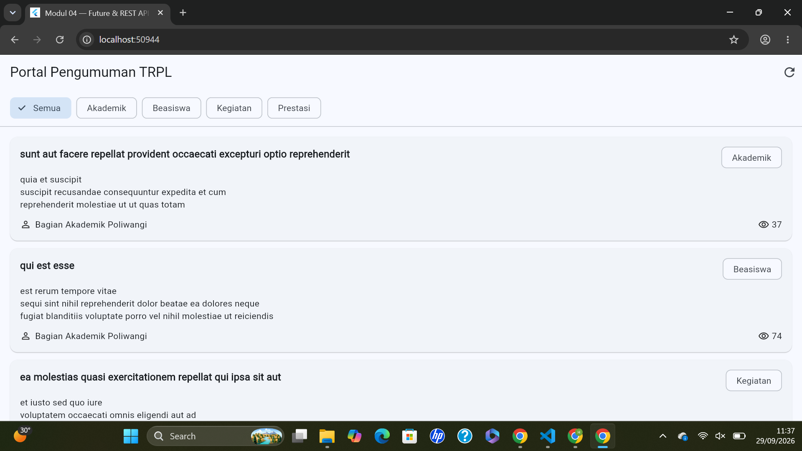
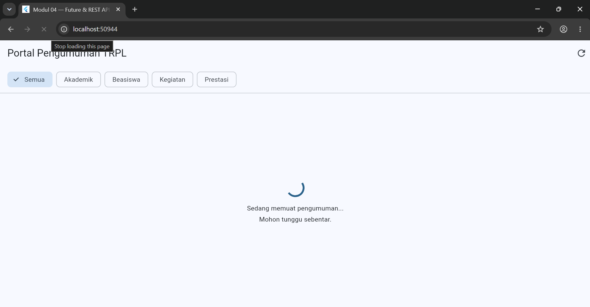
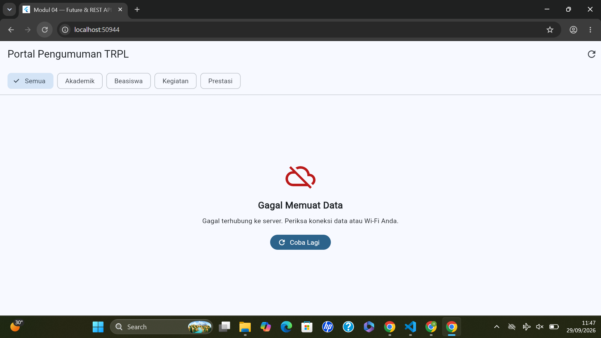
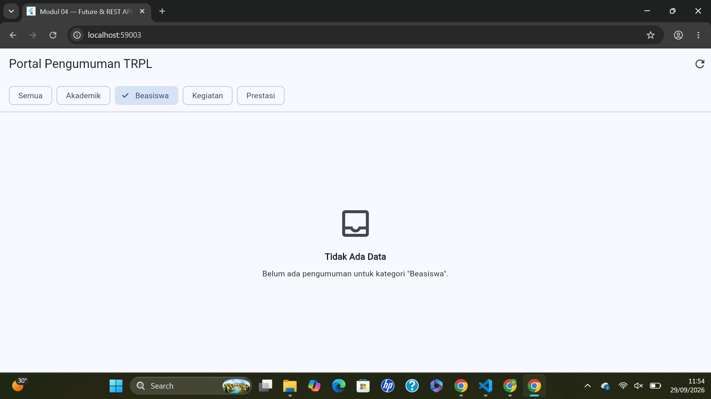

# RuangKita

RuangKita adalah aplikasi Flutter yang digunakan untuk menampilkan informasi
ketersediaan dan jadwal penggunaan ruang laboratorium.

## Identitas

- Nama: Hendra Yudha Pratama
- NIM: 362558302101
- Mata Kuliah: Pemrograman Mobile

## Deskripsi Project

Aplikasi RuangKita dibuat untuk memudahkan pengguna melihat informasi
ruangan laboratorium, aktivitas praktikum, jadwal penggunaan ruangan,
serta status ruangan.

Aplikasi memiliki tampilan dashboard yang responsif sehingga dapat
menyesuaikan tampilan pada berbagai ukuran layar.

## Fitur RuangKita

- Menampilkan daftar ruang laboratorium
- Menampilkan nama kegiatan/praktikum
- Menampilkan jadwal penggunaan ruangan
- Menampilkan status ruangan
- Filter ruangan berdasarkan status
- Melihat detail ruangan
- Tampilan responsif untuk berbagai ukuran layar

## Status Ruangan

Status ruangan yang tersedia:

- Berlangsung
- Akan Datang
- Selesai
- Tersedia

## Teknologi

- Flutter
- Dart
- Material Design
- Responsive Layout

## Cara Menjalankan Project

Pastikan Flutter sudah terinstall, kemudian jalankan:

```bash
flutter pub get
flutter run

# Modul 04 — Future & REST API Dasar

## Portal Pengumuman TRPL

Project Flutter untuk praktikum Modul 04 mengenai Future,
REST API, JSON, FutureBuilder, dan pengelolaan kondisi data.

## Fitur

- Mengambil data dari REST API
- Menampilkan data pengumuman
- Filter berdasarkan kategori
- Kondisi loading
- Kondisi error
- Kondisi data kosong
- Kondisi berhasil
- Refresh data
- Detail pengumuman

## Dokumentasi

### 1. Kondisi Berhasil



### 2. Kondisi Loading



### 3. Kondisi Error



### 4. Kondisi Kosong

